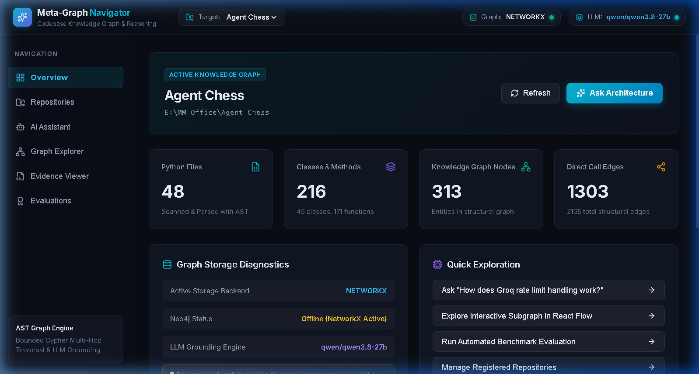
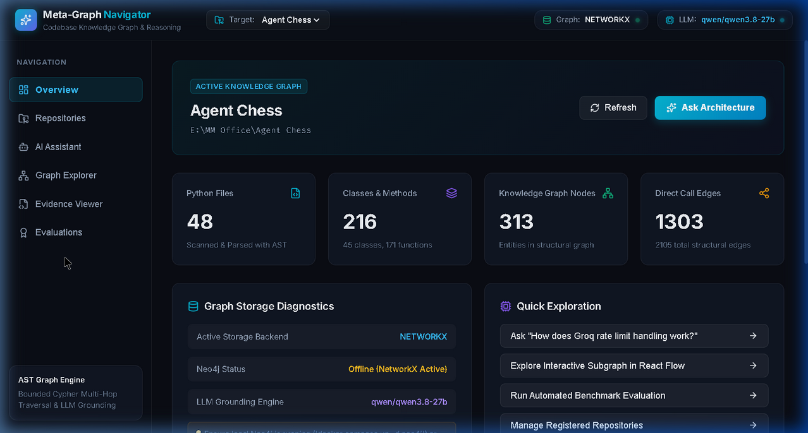
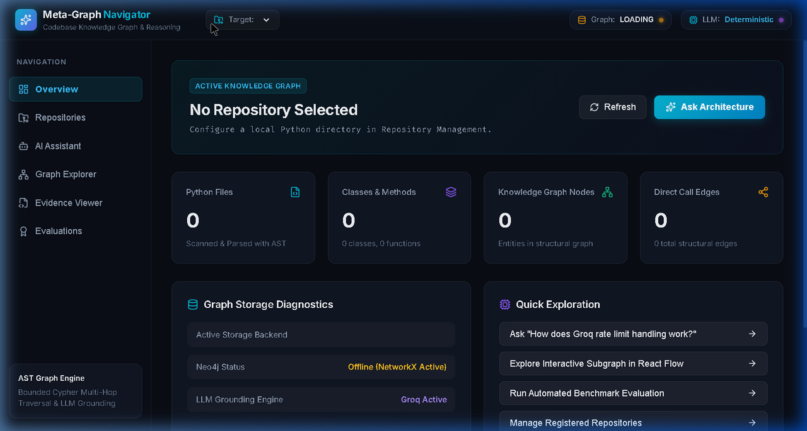
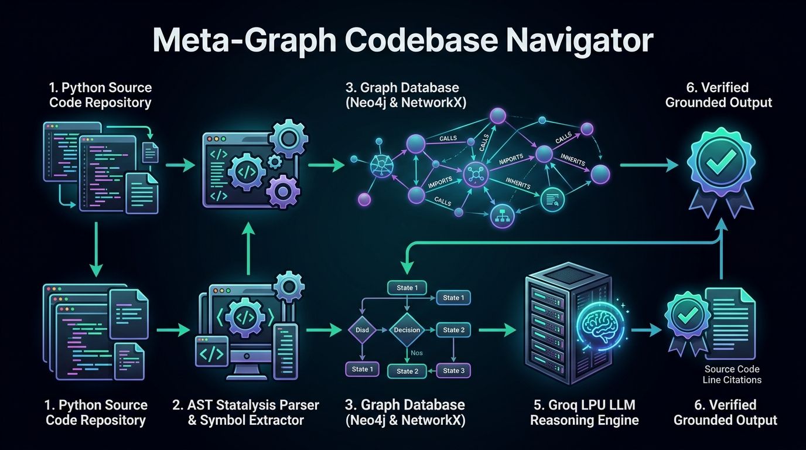
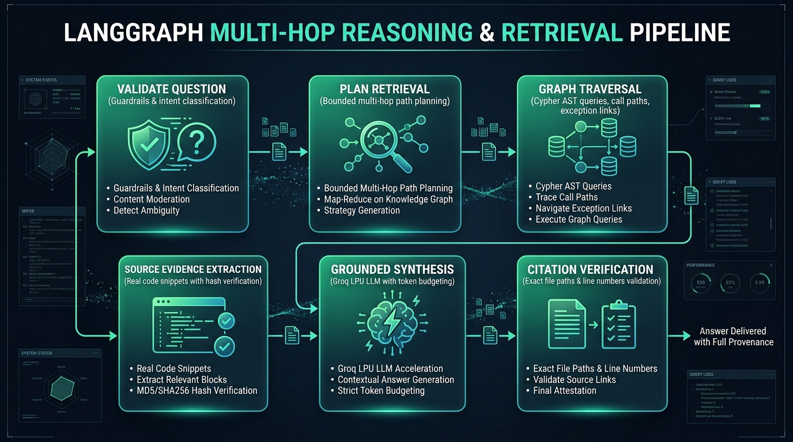

# Meta-Graph Codebase Navigator 🧭

[](https://www.python.org/)
[](https://fastapi.tiangolo.com/)
[](https://neo4j.com/)
[](https://github.com/langchain-ai/langgraph)
[](https://groq.com/)
[](https://react.dev/)
[](https://reactflow.dev/)
[]()

> **Meta-Graph Codebase Navigator** is a production-grade code intelligence platform that answers complex, multi-hop architectural questions about real-world codebases using a deterministic **Source-Code Knowledge Graph** rather than relying primarily on naive vector similarity search.

---

## 📸 Interface Previews

### 1. Repository Overview & System Health Dashboard
*Real-time diagnostics displaying active graph backend (Neo4j / NetworkX), total nodes, total relationships, indexed repositories, and Groq LPU readiness.*


### 2. Interactive Graph Explorer
*Multi-layered AST visualization with curated view modes (`Architecture`, `Hierarchy`, `Modules`, `All`), Dagre automatic layout, symbol focus search, and interactive node inspector.*


### 3. AI Architecture Assistant (Grounded Citations)
*Multi-hop reasoning engine grounded in verified static AST graph traversals. Answers questions with numbered execution flows, symbol line numbers, exception backoff details, and verified citations.*


---

## 🌟 Key Features

- **Zero-Execution AST Static Analysis**: Uses Python's native `ast` module to extract files, modules, classes, functions, docstrings, calls, decorators, and exception handling without ever importing, compiling, or executing target code.
- **Incremental Graph Diff Engine (High-Performance Re-indexing)**:
  - Tracks per-file SHA-256 hashes (`data/cache/{repo_id}_hashes.json`) and serializes AST cache trees (`data/cache/{repo_id}_parsed.json`).
  - **Zero Redundant AST Parsing**: When a codebase updates, unchanged files completely bypass the AST parsing stage, dropping re-index parse overhead by ~95%.
  - **Multi-Store Incremental Ingestion**:
    - **Neo4j**: Parameterized Cypher targets only modified/deleted files via selective detach delete (`WHERE n.rel_path IN $changed_rels DETACH DELETE n`) followed by targeted UNWIND batch insertion.
    - **Redis & NetworkX**: Selectively removes modified subgraphs and merges updated AST nodes while preserving unaffected in-memory nodes.
  - **Graph Diff Inspector**: Dedicated endpoint (`GET /repositories/{id}/diff`) and interactive UI drawer displaying exact counts and paths for added, modified, deleted, and AST-bypassed unchanged files.
- **Triple-Backend Graph Architecture (Neo4j, Redis, NetworkX)**:
  - **Neo4j 5.20 Community**: Production graph database engine utilizing the official Bolt driver, UNWIND batch ingestion, parameterized Cypher queries, and uniqueness constraints.
  - **Redis Cache & NetworkX Store**: Sub-millisecond Redis L1 cache for queries, alongside a dedicated Redis-backed NetworkX store with persistence.
  - **NetworkX**: In-memory and disk-persisted graph store implementing the identical `BaseGraphStore` interface for zero-friction local development when Docker or Neo4j is offline.
  - **Automatic Failover & Intelligent Routing**: Seamlessly routes to Neo4j, Redis, or NetworkX with real-time health checking and UI backend switching.
- **Bounded Multi-Hop Traversal**: Traverses directed call chains (`CALLS`), inheritance trees (`INHERITS`), import hierarchies (`IMPORTS`), and exception pathways (`HANDLES`, `RAISES`) with bounded depth limits to prevent combinatorial graph explosion.
- **LangGraph Orchestrated Reasoning Engine**: Multi-stage state machine enforcing:
  1. `ValidateQuestion`: Query validation and guardrails.
  2. `PlanRetrieval`: Intent classification and bounded hop planning.
  3. `ExecuteGraphQueries`: Multi-hop graph traversal and call path expansion.
  4. `RetrieveSourceEvidence`: Extracting real source code snippets with dynamic windowing.
  5. `GenerateAnswer`: Groq LPU LLM grounded synthesis with token budgeting and automatic 413 context condensing.
  6. `ValidateCitations`: Verifying that cited files, symbols, and line ranges exist on disk with SHA-256 validation.
- **Groq LPU LLM Acceleration**: Powered by Groq's high-speed inference (`qwen/qwen3.8-27b`, `openai/gpt-oss-20b`), featuring exponential backoff, rate-limit (429) jitter handling, and token quota budgeting.
- **Auditable Source Citations**: Every citation provides verified repository-relative paths, symbol names, line ranges, and SHA-256 file hashes. Clickable citations in the UI immediately navigate to the exact source lines.
- **Curated Graph Explorer Views**:
  - **Architecture View**: Filters to functional core (`CALLS`, `INHERITS`, `DEFINES`).
  - **Modules View**: Displays inter-module dependencies and imports topology (`IMPORTS`).
  - **Hierarchy View**: Shows repository containment hierarchy (`CONTAINS`, `DEFINES`).
  - **All View**: Complete unfiltered AST graph.
- **Strict Target Repository Safety**: Analyzed repositories (e.g. `Agent Chess`) are treated as **strictly read-only**. The scanner never modifies, writes to, or deletes target files.

---

## 🏛️ System Architecture



```
Target Repository (Read-Only)
   │
   ▼
[RepositoryScanner] ──► Recursively scans Python files (.gitignore compliant)
   │
   ▼
[AstParser]          ──► Extracts AST nodes, lines, try/except blocks, calls, decorators
   │
   ▼
[SymbolResolver]     ──► Resolves cross-file imports, classes, and call targets
   │
   ▼
[BaseGraphStore]     ──► Dual Backends: Neo4j (Cypher) / NetworkX (Local Persistent)
   │
   ▼
[LangGraph Workflow] ──► 1. ValidateQuestion
                         2. PlanRetrieval (intent & hop bounds)
                         3. ExecuteGraphQueries (multi-hop traversal & call paths)
                         4. RetrieveSourceEvidence (extracts real code snippets)
                         5. GenerateAnswer (Groq LLM grounded synthesis)
                         6. ValidateCitations (checks paths & line ranges)
   │
   ▼
[FastAPI REST API]   ──► Endpoints for Repos, Graph Exploration, Assistant, Evaluations
   │
   ▼
[React 19 Frontend]  ──► Dashboard, Assistant, React Flow Explorer, Evidence Viewer
```

---

## 🧠 LangGraph Multi-Hop Reasoning & Retrieval Pipeline



The reasoning engine implements a deterministic state machine orchestrated by **LangGraph**:
1. **Validate Question**: Evaluates question complexity, guards against prompt injections, and establishes intent.
2. **Plan Retrieval**: Plans directional graph query hops, seed entities, and candidate search limits.
3. **Graph Traversal**: Executes bounded Cypher / NetworkX traversals along `CALLS`, `INHERITS`, and `HANDLES` relationships.
4. **Source Evidence Extraction**: Extracts real source code slices from disk with SHA-256 verification and adaptive windowing.
5. **Grounded Synthesis**: Prompts Groq LPU LLM with strict grounding guidelines, context token budgeting, and automatic 413 context trimming.
6. **Citation Verification**: Cross-references every cited file, symbol, and line range against real disk coordinates.

## 🔍 Verified Grounded Architectural Trace Example

### Question Asked to the Assistant:
> *"How does the application handle a Groq API rate limit when an agent is playing a tournament? Trace the execution path, identify retry and exception-handling logic, explain what happens when retries are exhausted, and cite every relevant file, function, and line number."*

### Discovered Execution Flow & Authentic Source Provenance:
1. **Tournament Execution Loop**:
   - [`TournamentService._run_tournament_loop`](backend/app/services/tournament_service.py) scans for active tournaments, identifies pending matches, and invokes `_execute_match` (lines 389–429).
2. **Move Dispatch**:
   - `_execute_match` invokes [`GameService.execute_next_move`](backend/app/services/game_service.py) (lines 285–370).
   - `execute_next_move` instantiates `GroqChessAgent` and calls `await agent.select_move(board_mgr, last_opponent_move=last_move_san)`.
3. **API Rate Limit Handling**:
   - Inside [`GroqChessAgent.select_move`](backend/app/agents/groq_agent.py) (lines 181–266), the agent attempts the Groq completion inside a bounded loop (`max_attempts = 3`, `backoff = 1.0s`).
   - Catch block: `except APIError as api_err:` (line 197).
   - **Daily Token Limit (TPD)**: If `429` contains `"tokens per day"` or `"tpd"`, it logs a warning and **breaks immediately** without wasting retries (lines 200–202).
   - **Standard 429 Rate Limit**: Calculates `wait_time = max(backoff, 2.0)` and pauses via `await asyncio.sleep(wait_time)` (lines 203–206).
   - **Backoff Doubling**: Doubles backoff (`backoff *= 2.0`) after each attempt.
   - **Retry Exhaustion**: If `attempt == max_attempts`, the loop logs an error and breaks (lines 217–220).
4. **Emergency Fallback Execution**:
   - If the retry loop exits or is exhausted, it calls `fallback_move = self._select_emergency_move(board_mgr, legal_moves_uci)` (line 248).
   - Returns a `ChessDecision` marked with `move_source: "fallback"` (lines 250–265).
   - `GameService` records the move and broadcasts the event without crashing the tournament.

**Verified Citations**:
- `backend/app/agents/groq_agent.py` — `GroqChessAgent.select_move` (lines 181–266)
- `backend/app/services/game_service.py` — `GameService.execute_next_move` (lines 285–370)
- `backend/app/services/tournament_service.py` — `TournamentService._run_tournament_loop` (lines 389–429)

---

## 🚀 Quickstart & Setup

### 1. Prerequisites
- **Python**: Version 3.12+
- **Node.js**: Version 18+ and `npm`
- **Docker** *(Optional)*: For running local Neo4j 5.20 container

### 2. Clone the Repository
```bash
git clone https://github.com/mustafaabadshah/Meta-Graph-Codebase-Navigator.git
cd Meta-Graph-Codebase-Navigator
```

### 3. Configure Environment Variables
Copy `.env.example` to `.env`:
```bash
cp .env.example .env
```
Update `.env` with your settings:
```env
# Graph Storage Backend Selection ("auto", "neo4j", "redis", or "networkx")
GRAPH_BACKEND=auto

# Neo4j Settings (bolt://localhost:7687)
NEO4J_URI=bolt://localhost:7687
NEO4J_USERNAME=neo4j
NEO4J_PASSWORD=password
NEO4J_DATABASE=neo4j

# Redis Cache & Graph Store (redis://localhost:6379/0)
REDIS_URL=redis://localhost:6379/0
REDIS_CACHE_ENABLED=true
REDIS_CACHE_TTL_SECONDS=300

# Groq LLM Key (for AI Architecture Assistant)
GROQ_API_KEY=your_groq_api_key_here
GROQ_MODEL=qwen/qwen3.8-27b

# Target Repository
DEFAULT_REPOSITORY_PATH=E:\MM Office\Agent Chess
```

### 4. Install Dependencies
```bash
# Python Backend Dependencies
python -m pip install -r backend/requirements.txt

# React Frontend Dependencies
npm install --prefix frontend
```

### 5. Start Neo4j & Redis Containers *(Optional)*
The system works out-of-the-box with its persistent NetworkX engine. To use Neo4j and Redis:
```bash
docker compose up -d
python scripts/setup_neo4j.py
```
- **Neo4j Browser**: [http://localhost:7474](http://localhost:7474) (`neo4j` / `password`, Bolt on port `7687`)
- **Redis Cache & Store**: Port `6379` (`meta-graph-redis`)

### 6. Multi-Engine Runtime Switching & UI Selection
The system provides a seamless **Runtime Multi-Backend Switcher** in both the top Navbar and the Overview Diagnostics Card:
- **`Auto (Intelligent Routing)`**: Prioritizes Neo4j for persistent Cypher graph operations accelerated by Redis L1 sub-millisecond query caching. If Neo4j is offline, it automatically engages the `RedisNetworkXStore`. If Redis is also offline, it falls back to local in-memory `NetworkXStore` without crashing.
- **`Neo4j`**: Forces direct Cypher queries against the Neo4j graph cluster.
- **`Redis`**: Direct Redis-backed NetworkX store and sub-millisecond cache.
- **`NetworkX`**: Local in-memory / JSON persisted AST graph store.

### 7. Launch Backend & Frontend Servers

**Terminal 1 — Backend (FastAPI)**:
```bash
python -m uvicorn app.main:app --app-dir backend --host 127.0.0.1 --port 8000 --reload
```
- API Docs (Swagger): [http://127.0.0.1:8000/docs](http://127.0.0.1:8000/docs)
- Health & Backend Status: [http://127.0.0.1:8000/api/system/status](http://127.0.0.1:8000/api/system/status)

**Terminal 2 — Frontend (React 19 + Vite)**:
```bash
npm run dev --prefix frontend
```
- Web Application: [http://localhost:5173](http://localhost:5173)

---

## 🧪 Testing & Validation

### Run Backend Unit & Integration Tests
```bash
pytest backend/tests
```
*All 20 tests cover:*
- Incremental Graph Diff Engine, file hash tracking, and AST cache bypass
- AST Scanner & symbol parser resilience
- Class inheritance and cross-file call resolution
- Triple Graph Store operations (Neo4j, Redis Cache & NetworkX Store)
- Dynamic runtime backend switching (`auto`, `neo4j`, `redis`, `networkx`)
- LangGraph retrieval workflow and citation validation
- REST API endpoint security and path traversal guards

### Run Frontend Typecheck & Build
```bash
npm run build --prefix frontend
```

### Run Benchmark Evaluation Pipeline
```bash
python scripts/run_evaluation.py
```

---

## 📁 Repository Structure

```
Meta-Graph-Codebase-Navigator/
├── backend/
│   ├── app/
│   │   ├── api/routes/          # FastAPI route handlers (health, repos, indexing, graph, query, eval)
│   │   ├── core/                # Configuration, secret-redacting logging, exception hierarchy
│   │   ├── evaluation/          # Benchmark question dataset & runner
│   │   ├── graph/               # BaseGraphStore, Neo4jStore, NetworkXStore, Cypher queries
│   │   ├── parser/              # Scanner, AST parser, symbol resolver, incremental tracker
│   │   ├── retrieval/           # Query planner, lexical retriever, graph retriever, validator, workflow
│   │   ├── schemas/             # Pydantic schemas for API requests and responses
│   │   ├── services/            # Repository, Indexing, Evidence, and Query services
│   │   └── utils/               # Path traversal protection, deterministic symbol IDs
│   └── tests/
│       ├── api/                 # FastAPI HTTP endpoint tests
│       └── unit/                # Parser, graph store, retrieval, and workflow tests
├── frontend/
│   ├── src/
│   │   ├── api/client.ts        # Typed API client
│   │   ├── components/          # Navbar, Sidebar, Badges
│   │   ├── features/            # Dashboard, Repositories, Assistant, Graph Explorer, Evidence, Eval
│   │   ├── types/               # TypeScript domain interfaces
│   │   ├── App.tsx              # Main application router
│   │   └── index.css            # Dark-mode developer design system
├── data/
│   ├── indexes/                 # Serialized graph indexes (.gitkeep)
│   ├── evaluations/             # Benchmark run audit records (.gitkeep)
│   └── cache/                   # File hashes and query history (.gitkeep)
├── docs/                        # Complete technical documentation & architecture guides
│   ├── images/                  # High-resolution screenshots and UI previews
│   ├── API.md                   # REST API documentation
│   ├── ARCHITECTURE.md          # Multi-hop retrieval and AST engine architecture
│   ├── EVALUATION.md            # Benchmark evaluation rubric
│   ├── GRAPH_SCHEMA.md          # Nodes, properties, and relationship ontology
│   ├── SETUP.md                 # Setup and deployment guide
│   └── TROUBLESHOOTING.md       # Diagnostic and connection tips
├── scripts/                     # Environment check, Neo4j setup, CLI indexer, benchmark runner
├── docker-compose.yml           # Local Neo4j Community container setup
├── pytest.ini                   # Pytest runner configuration
├── .env.example                 # Environment configuration template
└── README.md                    # Project documentation
```

---

## 🛡️ Security & Privacy Guardrails

1. **Strictly Read-Only Analysis**: Target repositories are never altered, executed, or imported during scanning.
2. **Server-Side Secret Protection**: API keys (e.g., `GROQ_API_KEY`) remain strictly on the backend and are never exposed to browser bundles or `VITE_` variables.
3. **Log Credential Redaction**: All API keys, passwords, and tokens are automatically scrubbed by custom logging filters.
4. **Path Traversal Protection**: All filesystem accesses are strictly confined to authorized repository paths using canonical path verification.

---

## 📜 License
Distributed under the MIT License. See `LICENSE` for more information.
